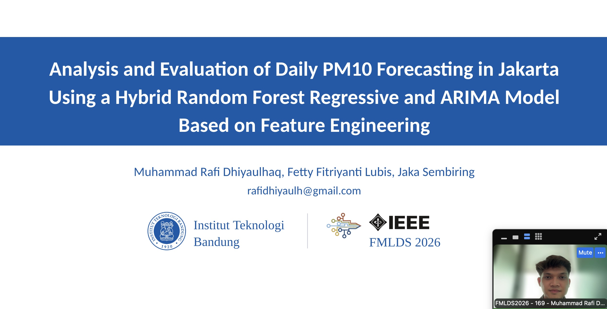

# Daily PM10 Forecasting in Jakarta with a Hybrid Random Forest and ARIMA Model

**Muhammad Rafi Dhiyaulhaq**, Information Systems and Technology, School of Electrical Engineering and Informatics, Institut Teknologi Bandung

Lecturer research project at ITB, supervised by Dr. Fetty Fitriyanti Lubis, S.T., M.T. Presented at IEEE FMLDS 2026 and also submitted as my undergraduate thesis (Grade A).



## Publication

M. R. Dhiyaulhaq, F. F. Lubis, and J. Sembiring, "Analysis and Evaluation of Daily PM10 Forecasting in Jakarta Using a Hybrid Random Forest Regressive and ARIMA Model Based on Feature Engineering," *2026 IEEE International Conference on Future Machine Learning and Data Science (FMLDS 2026)*.

Presented in Session W3B on 23 November 2026. [Paper](Muhammad%20Rafi%20Dhiyaulhaq_Paper.pdf) and [slides](presentation/FMLDS2026-169-W3B.pptx).

## Summary

Jakarta's air quality index (ISPU) only reports the past 24 hours. This work forecasts next-day PM10 from data available today.

- **Data:** 5,538 daily ISPU records for DKI Jakarta (2010 to 2025), split by time into 4,172 training and 1,043 test days.
- **Features:** 18 inputs known by day t-1: PM10 lags, rolling statistics, lagged gases, a CO x O3 photochemistry proxy and calendar flags.
- **Model:** an Optuna-tuned Random Forest learns the nonlinear part; ARMA(5,4) on its out-of-bag residuals adds a one-step correction.
- **Explainability:** TreeSHAP on the Random Forest stage.

## Results

1,043 test days (Oct 2021 to Feb 2025). Errors are in ISPU points.

| Model | RMSE | MAE | R² |
|---|---|---|---|
| **Hybrid RF-ARIMA** | **14.73** | **10.34** | **0.37** |
| Random Forest, Optuna-tuned | 14.82 | 10.55 | 0.36 |
| ARIMA(5,1,0), rolling | 15.23 | 10.70 | 0.32 |
| XGBoost, untuned | 16.52 | 12.09 | 0.20 |
| Persistence | 17.75 | 11.96 | 0.08 |

- 17.0% lower RMSE than persistence and 3.3% lower than rolling ARIMA (Diebold-Mariano, significant).
- The ARIMA stage adds only 0.63% over the tuned Random Forest (p = 0.168). PM10 lags and rolling features carry most of the skill.
- Top TreeSHAP drivers: 3-day and 7-day PM10 means, yesterday's PM10, and the dry season.

The paper uses a revised, leakage-free pipeline. Its results replace the evaluation figures in the thesis report.

## Repository

```
notebook/PM10_Forecasting.ipynb      Pipeline that reproduces the paper results
presentation/                        FMLDS 2026 slides and presentation photo
latex/                               Thesis LaTeX source
Muhammad Rafi Dhiyaulhaq.pdf         Thesis report
Muhammad Rafi Dhiyaulhaq_Paper.pdf   IEEE FMLDS 2026 paper
```

## Reproduce

Dataset: *Air Quality Index in Jakarta* (Kaggle), daily ISPU records 2010 to 2025.

```bash
pip install pandas numpy scikit-learn statsmodels xgboost optuna shap matplotlib seaborn
jupyter notebook notebook/PM10_Forecasting.ipynb
```

Thesis build (XeLaTeX and Biber):

```bash
cd latex && xelatex TA.tex && biber TA && xelatex TA.tex && xelatex TA.tex
```
